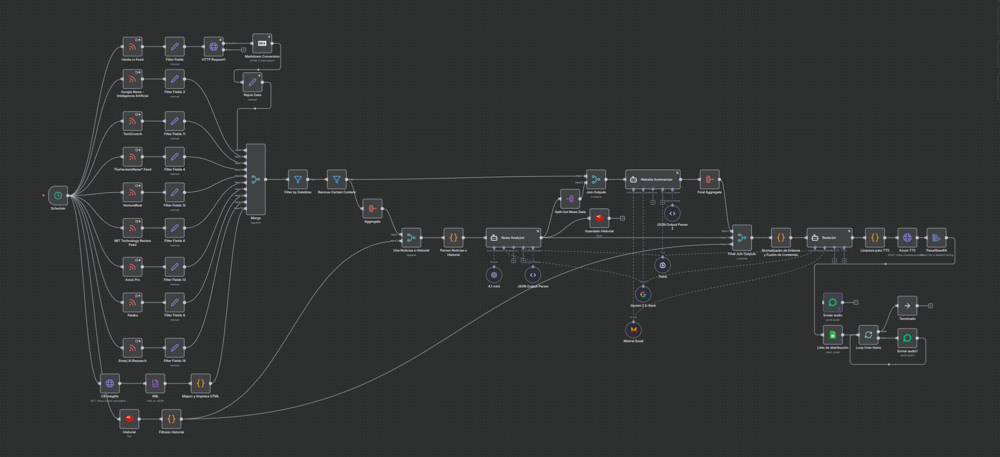

<p align="center">

</p>

# 1. Boletín de Audio: Tu Dosis Diaria de IA y Tech

Este workflow de n8n es un sistema de curación y generación de contenido totalmente automatizado. Su objetivo es resolver la sobrecarga de información tecnológica (especialmente en IA y ciencia de datos) y entregar un resumen de audio conciso y de alta calidad directamente por WhatsApp.

Cada madrugada, el flujo se activa, procesa noticias de decenas de fuentes tecnológicas de prestigio (como *MIT Technology Review*, *Xataka*, *The Hacker News*, etc.) y filtra el ruido (opiniones, rumores, duplicados) para quedarse solo con lo relevante.

Posteriormente, una **orquesta de tres Agentes de IA** colabora:

1.  Un **Analista** selecciona las 15 noticias más importantes del día, comparándolas con un historial de 7 días para evitar repeticiones.
2.  Un **Summarizer** lee y resume cada una de esas 15 noticias.
3.  Un **Guionista** toma los resúmenes y el contexto histórico para redactar un guion fluido y natural, en castellano, optimizado para audio.

Finalmente, el guion se convierte a voz con **PocketTTS**, un servicio TTS **autoalojado** que clona la voz del autor a partir de una referencia de unos 25 segundos. Si el servicio falla, una cadena de respaldo (**ElevenLabs** y después **Azure Speech**) garantiza la entrega. El audio resultante se distribuye como un único archivo a una lista de suscriptores en WhatsApp.

-----

## 📍 2. ¡Suscríbete al Boletín!

Puedes recibir este boletín de audio cada mañana (Lunes a Viernes, ~6:00 AM CET) de forma gratuita.

  * **Canal:** Envía un mensaje de WhatsApp al [**+34 665 656 404**](https://wa.me/34665656404)
  * **Mensaje:** `alta noticias`

La gestión de altas y bajas de esta lista de distribución se maneja a través de [**KykeBot**](https://github.com/funkykespain/workflows-n8n-publicos/tree/main/KykeBot), el asistente personal de Enrique Aranda.

-----

## ⚙️ 3. Requisitos Previos

Para que este workflow funcione, necesitarás:

  * Una instancia de **n8n** (local o en la nube) con estos requisitos:
      * Los nodos de comunidad [`n8n-nodes-evolution-api`](https://www.npmjs.com/package/n8n-nodes-evolution-api) y `@elevenlabs/n8n-nodes-elevenlabs`.
      * **ffmpeg** disponible dentro del contenedor de n8n (lo usa el nodo `wav2ogg`).
      * Permiso para usar `child_process` y `fs` en los nodos `Code` (variable de entorno `NODE_FUNCTION_ALLOW_BUILTIN`), necesario para `wav2ogg`.
      * Una carpeta con escritura en `/home/node/boletin` (monta un volumen) para la copia del último boletín. (Para que se escuche [aquí](https://kyke.dpdns.org)  también.)
  * Un **servidor propio para el servicio PocketTTS** (contenedor Docker, solo CPU, ver [sección 8](https://github.com/funkykespain/workflows-n8n-publicos/tree/main/Noticias#%EF%B8%8F-8-voz-autoalojada-pockettts)), en la misma red Docker que n8n, y un token de **Hugging Face**.
  * Una puerta de enlace de **WhatsApp API**, como **Evolution API** (usada en este flujo).
  * Una base de datos **Redis** (para el historial de noticias).
  * Una cuenta de **Google Sheets** (para leer la lista de distribución).
  * Una instancia de un servicio de navegador headless (ej. **browserless**) para el scraping profundo de contenido.
  * Credenciales de API para:
    * **OpenRouter** (Gemini 2.5 Flash Lite, IBM Granite 4.2 8B y Qwen 3.5 9B).
    * **Google Gemini** (Agente Guionista, Gemini 3.5 Flash Lite).
    * **Ollama** con acceso a modelos cloud (`gpt-oss:120b-cloud` y `gpt-oss:20b-cloud`, como respaldo).
    * **ElevenLabs** (primer respaldo de voz).
    * **Azure Speech** (último respaldo de voz, autenticación por cabecera HTTP).

-----

## 📦 4. Archivos Incluidos

  * `Noticias.json`: El export completo del workflow de n8n.
  * `PocketTTS/docker-compose.yml`: Despliegue del servicio de voz autoalojado (ver [sección 8](https://github.com/funkykespain/workflows-n8n-publicos/tree/main/Noticias#%EF%B8%8F-8-voz-autoalojada-pockettts)).
  * `profile.png`: Imagen de perfil del bot.
  * `schema.png`: Diagrama visual del workflow.
  * `README.md`: Este documento explicativo.

-----

## 🚀 5. Instalación e Importación del Workflow

1.  **Despliega PocketTTS** siguiendo la [sección 8](https://github.com/funkykespain/workflows-n8n-publicos/tree/main/Noticias#%EF%B8%8F-8-voz-autoalojada-pockettts) y comprueba que responde en `http://<host>:8080/tts`.
2.  Descarga el archivo `Noticias.json`.
3.  En tu instancia de n8n, ve a **Import > From File**.
4.  Selecciona el archivo `Noticias.json` y guarda el workflow.
5.  **Importante:** Este flujo utiliza múltiples credenciales (ver sección de Requisitos). Deberás crear y asignarlas en los nodos correspondientes:
    * Agentes y modelos: `News Analyzer`, `Website Summarizer`, `Redactor`, `Information Extractor` y los nodos de modelo conectados a ellos.
    * Voz: `PocketTTS` (ajusta la URL del servicio y `voice_url`), `Daniel`, `Daniel2` y `Daniel3` (ElevenLabs) y `Teo` (Azure).
    * Distribución: `Lista de distribución`, `Validar Numero`, `Enviar Boletin`.
    * Memoria: `Historial` y `Guardado Historial` (Redis).
6.  Configura el `Schedule` (disparador) a la hora que desees. Deja margen suficiente para que la generación de audio en CPU termine antes de la hora de entrega.
7.  Activa el workflow.

-----

## 🧩 6. Estructura del Workflow

Este workflow se inicia con un nodo `Schedule` que se ejecuta todos los días laborables a las **4:45 AM** (zona horaria `Europe/Madrid`).


El flujo se puede dividir en cinco fases principales:

### Fase 1: Recolección y Filtrado (El "Curador")

1.  **Disparador:** El nodo `Schedule` inicia el flujo (L-V, **4:45 AM**).
2.  **Recolección (Multicanal):**
      * **Lectura RSS/API:** La mayoría de las fuentes se leen vía `RSS Feed Read` o `HTTP Request` estándar. Las fuentes actuales son: *lobste.rs*, *Google News (Inteligencia Artificial)*, *The Hacker News*, *MIT Technology Review*, *Xataka*, *TechCrunch*, *Axios*, *Emerj AI Research*, *CB Insights* y *VentureBeat*. Las dos últimas se leen por `HTTP Request` + `XML` y se normalizan con un nodo `Code` de mapeo y limpieza.
      * **Scraping Profundo:** Para fuentes clave (ej. *Lobste.rs*), el flujo es mucho más robusto:
        1.  Lee el RSS (`lobste.rs Feed`) para obtener el enlace.
        2.  Envía el enlace a un servicio **browserless** (`HTTP Request`) para obtener el HTML completo de la página.
        3.  Convierte el HTML a Markdown (`Markdown Conversion`) y lo pre-filtra (`Pre-limpieza`).
        4.  Un nodo `Information Extractor` (Qwen 3.5 9B vía OpenRouter) **limpia este Markdown** y extrae únicamente el contenido principal del artículo, descartando menús, anuncios y pies de página.
        5.  Se reestructura el dato (`Restructurar`) antes de unificarlo.
3.  **Estandarización:** Varios nodos `Set` (`Filter Fields`) unifican los datos en un formato común (título, pubDate, link, content).
4.  **Filtro de Fecha:** Un nodo `Filter` (`Filter by Datetime`) descarta noticias con más de 24 horas (o 72h los lunes).
5.  **Filtro de Contenido:** Un nodo `Filter` (`Remove Certain Content`) elimina artículos irrelevantes usando palabras clave (opinion, rumour, layoff, offer, discount, etc.).
6.  **Agregación:** Un nodo `Aggregate` agrupa todas las noticias limpias del día.

### Fase 2: Carga de Contexto Histórico

1.  **Lectura de Historial:** Un nodo `Redis` (`Historial`) lee la lista `historial_noticias` que contiene los titulares de los últimos días.
2.  **Filtro de Historial:** Un nodo `Code` (`Filtrado Historial`) procesa este historial para quedarse solo con las noticias de los últimos 7 días.

### Fase 3: La Orquesta de Agentes de IA

Esta es la lógica central donde tres agentes colaboran, cada uno con un LLM principal, un LLM de respaldo en otro proveedor y un *prompt* especializado.

| Agente | Modelo principal | Modelo de respaldo |
|---|---|---|
| News Analyzer | Gemini 2.5 Flash Lite (OpenRouter) | gpt-oss 120B cloud (Ollama) |
| Website Summarizer | IBM Granite 4.2 8B (OpenRouter) | gpt-oss 20B cloud (Ollama) |
| Redactor | Gemini 3.5 Flash Lite (Google) | IBM Granite 4.2 8B (OpenRouter) |
| Information Extractor | Qwen 3.5 9B (OpenRouter) | — |

1.  **Agente 1: El Analista (`News Analyzer`)**

      * **Entrada:** Recibe la lista completa de noticias de *hoy* y el historial de *7 días* (tras `Une Noticias e Historial` y `Limpieza Pro-Análisis`).
      * **Tarea:** Su *prompt* le instruye para actuar como analista, priorizando IA y Data Science, y aplicando filtros semánticos (para no repetir temas del historial) y de diversidad (para no incluir más de 2 noticias de la misma fuente).
      * **Salida:** Devuelve un JSON con el **Top 15** de noticias (título y link).

2.  **Agente 2: El Resumidor (`Website Summarizer`)**

      * **Entrada:** Para cada una de las 15 noticias seleccionadas, el flujo descarga la página (`HTTP Request1`), la convierte a Markdown (`Markdown Conversion1`) y descarta el contenido inservible (`Solo Contenido Bueno`).
      * **Tarea:** Su *prompt* le ordena devolver un JSON con un resumen de una sola frase concisa para cada artículo, en español de España e ignorando el ruido de la web.
      * **Salida:** Devuelve 15 resúmenes.

2.1. **Normalización y Fusión Inteligente**

  * **Nodo:** `Normalizador de Enlaces y Fusión de Contenido`.
  * **Tarea:** Este nodo de código crucial recibe los **15 resúmenes** del Agente 2 y las **15 noticias** del Agente 1. Compara las URLs de ambas listas usando un cálculo de similitud (distancia de Levenshtein, como se ve en las funciones `getEditDistance` y `calculateSimilarity` del código).
  * **Salida:** Logra emparejar resúmenes con sus titulares incluso si las URLs difieren ligeramente (ej. `http` vs `https`), asegurando la integridad de los datos que recibe el Guionista.

2.2. **Efemérides**

  * **Nodo:** `Efemérides` (`Code`), justo antes del Guionista.
  * **Tarea:** Detecta si el día tiene una efeméride (IA, rock, batería, festivos…) y la pasa al Guionista para que abra el boletín con un saludo contextual.

<!-- end list -->

3.  **Agente 3: El Guionista (`Redactor`)**
      * **Entrada:** Recibe los 15 resúmenes, la efeméride del día y el historial de 7 días (para contexto).
      * **Tarea:** Su *prompt* es el más complejo. Le exige actuar como redactor de guiones para audio (voz sintética), en español de España. Debe escribir un guion fluido, natural, con saludo y despedida, conectando las noticias y haciendo referencias al contexto histórico (ej. "dando continuidad a lo que vimos la semana pasada..."). Entre sus reglas: texto plano, sin Markdown, listas ni encabezados; términos técnicos traducidos al español salvo nombres propios y argot consolidado; puntos solo para cerrar frases y comas para las pausas internas; párrafos de 2 a 3 líneas.
      * **Salida:** Un bloque de texto plano listo para ser locutado.

### Fase 4: Generación y Distribución de Audio

1.  **Limpieza de Texto:** Un nodo `Code` (`Limpieza para TTS`) prepara el guion para la voz:
      * Convierte símbolos a palabras (`&`, `%`, `€`, etc.) y elimina restos de marcado.
      * Pasa los números a letra en español (fechas, cifras, decimales).
      * Aplica un **diccionario de pronunciación** editable para marcas y siglas (ej. `STEP2HAD`, `AWS`, `HP`) y suaviza palabras en mayúsculas.
      * Elimina `&`, `<` y `>`, de modo que el texto sea seguro también dentro de SSML (lo usa el último respaldo, Azure).
2.  **Generación de Audio Resiliente (en cascada):** cada nodo tiene reintentos propios y pasa a la siguiente opción si falla (`onError: continueErrorOutput`).
      * **Intento 1 (PocketTTS):** servicio autoalojado con la voz clonada del autor (ver [sección 8](#-8-voz-autoalojada-pockettts)). El nodo `wav2ogg` convierte su WAV a **Opus mono 48 kHz** con ffmpeg.
      * **Intento 2 (ElevenLabs):** nodos `Daniel` (modelo `eleven_multilingual_v2`), `Daniel2` (modelo `eleven_multilingual_sts_v2`) y `Daniel3`, encadenados en ese orden.
      * **Intento 3 (Azure Speech):** nodo `Teo`, voz `es-ES-TeoNeural`, mediante SSML.
3.  **Comprobación y copia:** `Existe binario?` verifica que hay audio. Si lo hay, `PasarBase64` lo convierte a Base64 para la API de WhatsApp y `Guardar en VPS` escribe una copia en `/home/node/boletin/ultimo-boletin.mp3`.
4.  **Pausa Estratégica:** Tras generar el audio, un nodo `Wait` (`Espera hasta las 6h`) detiene el flujo hasta que sean exactamente las 6:00 AM CET. Si el procesamiento terminara después de las 6:00 AM, el flujo continuaría inmediatamente. Esto desacopla el tiempo de procesamiento del de entrega, asegurando un envío predecible.
5.  **Lista de Suscriptores:** Un nodo `Google Sheets` (`Lista de distribución`) lee la hoja de cálculo donde KykeBot gestiona las altas.
6.  **Envío:** Un nodo `Loop Over Items` itera sobre cada suscriptor. Tras validar el número (`Validar Numero`), un nodo `Evolution API` (`Enviar Boletin`) envía el audio (`send-audio`) al `jid` resuelto (ver la actualización v2.3.6 más abajo).

### Fase 5: Retroalimentación (Logging)

  * **Guardado de Historial:** En paralelo a la distribución, un nodo `Redis` (`Guardado Historial`) toma la salida del Top 15 del **Agente 1** y la guarda en la lista `historial_noticias` en Redis. Esto asegura que el agente de mañana tenga el contexto de las noticias de hoy.

-----

### 🔄 Actualización del Flujo: Validación de Identidad y Pre-calentamiento (Fix v2.3.6)

Se ha refactorizado la lógica dentro del bucle de la lista de distribución (`Loop Over Items`) para mitigar el error *"Esperando mensaje. Esto puede tomar tiempo"* y asegurar la entrega en la arquitectura Multi-Dispositivo (MD) de WhatsApp.

**Problema Solucionado:**
Anteriormente, el envío directo al número de teléfono (`@s.whatsapp.net`) sin una sesión activa provocaba fallos de desencriptación en destinatarios que utilizan la nueva arquitectura de identificadores privados (`@lid`).

**Nueva Arquitectura del Bucle:**

El flujo ahora implementa un patrón **"Validar antes de Enviar"** (Check-then-Send) que consta de los siguientes pasos para cada usuario:

1.  **Validar Número (HTTP Request):**
    *   **Endpoint:** `/chat/whatsappNumbers`
    *   **Acción:** Antes de enviar el multimedia, se consulta el estado del número en la API.
    *   **Propósito Técnico:** Esta consulta fuerza a Evolution API a refrescar la caché de mapeo `LID ↔ Phone Number` y negocia las claves de cifrado (PreKeys) con los servidores de Meta en tiempo real. Actúa como un "pre-calentamiento" de la sesión.

2.  **Normalizar Respuesta (Code Node):**
    *   Procesa la respuesta de la API para extraer el **JID canónico** (`jid`).
    *   Este JID es la dirección exacta (sea `@lid` o `@s.whatsapp.net`) que WhatsApp espera recibir en ese preciso milisegundo, garantizando que el canal de encriptación sea el correcto.

3.  **Enviar Audio (Evolution API Node):**
    *   **Destinatario:** Ya no usa el número crudo del Excel, sino el `{{ $json.jid }}` obtenido del paso de validación.
    *   **Delay:** Se ha configurado un retraso interno (`delay: 2000` ms) que muestra "Grabando audio..." al usuario. Esto cumple doble función: mejora la experiencia de usuario y da tiempo a la API para consolidar la sesión de cifrado iniciada en el paso 1.

4.  **Control de Cadencia (Wait Node):**
    *   **Ubicación:** Cierra el ciclo del bucle, ejecutándose tras el envío del audio y antes de procesar el siguiente suscriptor.
    *   **Configuración:** Retraso fijo de **5 segundos**.
    *   **Propósito Técnico:** Implementa un *Rate Limiting* a nivel de aplicación. Esto cumple dos funciones críticas: libera la cola de procesamiento de la instancia de Evolution API (evitando cuellos de botella en la encriptación) y protege la reputación del número ante los algoritmos anti-spam de Meta, simulando un comportamiento de envío humano no instantáneo.

**Resultado:**
Esta estructura garantiza que cada mensaje de la lista de distribución se envíe a través de un "túnel" de encriptación verificado y activo, eliminando los mensajes ilegibles por desincronización de claves.

-----

### 🔄 Actualización del Flujo: Voz propia autoalojada (PocketTTS)

La generación de voz dejó de depender de un único proveedor externo (antes, Azure con la voz `es-ES-AlvaroNeural`).

**Cambios:**

1.  **Voz principal:** servicio **PocketTTS** autoalojado que clona la voz del autor (ver [sección 8](#-8-voz-autoalojada-pockettts)).
2.  **Cadena de respaldo:** PocketTTS → ElevenLabs (tres intentos) → Azure Speech.
3.  **Pausa de las 6:00:** ahora se aplica **después** de generar el audio, y no antes de la limpieza del texto.
4.  **Horario:** el flujo arranca a las 4:45 AM para dejar margen a la generación de audio en CPU.
5.  **Limpieza del texto:** el nodo `Limpieza para TTS` pasa los números a letra y aplica un diccionario de pronunciación de marcas y siglas.
6.  **Modelos:** los tres agentes tienen respaldo en otro proveedor (OpenRouter, Google y Ollama).

-----

## 🔧 7. Optimizaciones y Características Clave

  * **Orquestación Multi-Agente:** En lugar de un solo LLM monolítico, se usan tres agentes especializados. Esto reduce la carga cognitiva de cada agente, mejora la fiabilidad de cada paso y permite usar el LLM más adecuado (y económico) para cada tarea (análisis, resumen, redacción).
  * **Respaldo de LLM por Agente:** cada agente tiene un modelo alternativo en otro proveedor. Si uno cae o se queda sin cuota, el boletín no se detiene.
  * **Curación por Contexto (RAG Ligero):** El uso del historial de Redis de 7 días actúa como una forma de RAG. El **Agente 1** (Analista) lo usa para filtrar duplicados y el **Agente 3** (Guionista) lo usa para dar continuidad narrativa a los temas.
  * **Optimización para Audio (TTS):** El *prompt* del Guionista y el nodo de limpieza (`Limpieza para TTS`) están diseñados específicamente para generar un texto que suene natural y profesional cuando es procesado por una voz neural: números a letra, diccionario de pronunciación para marcas y siglas, y puntuación pensada para las pausas.
  * **Voz Propia Autoalojada:** el audio principal se genera con una voz clonada en tu propia infraestructura, sin coste por carácter y sin depender de un proveedor externo para el caso habitual.
  * **Resiliencia de Audio en Cascada:** PocketTTS → ElevenLabs (tres intentos) → Azure Speech. Cada nivel tiene reintentos propios, de forma que el boletín se entrega aunque falle el servicio principal.
  * **Filtrado Robusto:** El flujo no solo filtra por palabras clave (`Remove Certain Content`), sino también por fecha (`Filter by Datetime`) y, lo más importante, semánticamente (Agente 1), asegurando una alta calidad y relevancia del contenido final.
  * **Gestión de Fuentes:** El flujo agrega diez fuentes de primer nivel y es capaz de manejar formatos distintos (RSS y scraping de XML/HTML), unificándolos antes de pasarlos a la IA.
  * **Scraping de Contenido Profundo:** En lugar de depender de resúmenes de RSS (a menudo incompletos), el flujo puede activar un navegador *headless* (`browserless`) y usar IA (`Information Extractor`) para leer y limpiar el contenido real del artículo, proporcionando resúmenes de mucha mayor calidad al **Agente 2**.
  * **Fusión Inteligente de Datos:** El nodo `Normalizador de Enlaces` actúa como un "control de calidad", usando la distancia de Levenshtein para emparejar títulos y resúmenes aunque sus URLs no coincidan perfectamente.
  * **Gestión Activa de Sesiones (Zero-Fail E2EE):** A diferencia de los bots tradicionales que envían mensajes "a ciegas", este flujo implementa un patrón *Check-then-Send*. Valida criptográficamente la sesión del usuario contra los servidores de Meta antes de enviar archivos pesados, resolviendo dinámicamente la dualidad de identificadores (`LID` vs `PN`) y eliminando virtualmente el error "Esperando mensaje. Esto puede tomar tiempo" en la arquitectura multidispositivo.

-----

## 🎙️ 8. Voz autoalojada: PocketTTS

El audio principal lo genera [Kyutai Pocket TTS](https://github.com/kyutai-labs/pocket-tts) en un contenedor propio, clonando la voz del autor a partir de una referencia de unos 25 segundos. n8n lo llama por la red interna con `POST /tts` en `multipart/form-data`, con dos campos:

  * `text`: el guion ya limpio (`cleanedTextForTTS`).
  * `voice_url`: la URL de la referencia de voz (ver más abajo).

La respuesta es un WAV, que el nodo `wav2ogg` convierte a Opus antes de enviarlo por WhatsApp.

### Despliegue

Fichero `PocketTTS/docker-compose.yml`:

```yaml
services:
  pockettts:
    build:
      context: .
      dockerfile_inline: |
        FROM python:3.12-slim
        RUN apt-get update && apt-get install -y \
            ffmpeg libsndfile1 curl \
            && rm -rf /var/lib/apt/lists/*
        RUN pip install --no-cache-dir "pocket-tts==3.0.2"
        EXPOSE 8080
        ENTRYPOINT ["/bin/bash", "-c", "python -m http.server 8081 --bind 127.0.0.1 --directory /models/voice >/dev/null 2>&1 & exec pocket-tts serve --host 0.0.0.0 --port 8080 --language spanish_24l --quantize"]
    env_file:
      - .env
    volumes:
      - pockettts_models:/models
    restart: unless-stopped

volumes:
  pockettts_models:
```

El fichero `.env` contiene únicamente el token de Hugging Face (los pesos del modelo se descargan de un repositorio restringido):

```
HF_TOKEN=hf_xxxxxxxxxxxxxxxx
```

Una vez desplegado, copia la referencia de voz al volumen:

```bash
docker cp ref_new.wav <nombre_del_contenedor>:/models/voice/ref_new.wav
```

En el nodo `PocketTTS` de n8n, configura:

  * **URL:** `http://<host_del_servicio>:8080/tts` (el nombre de host depende de tu red Docker o de tu panel).
  * **Body (Form-Data):** `text` = `{{ $('Limpieza para TTS').item.json.cleanedTextForTTS }}` y `voice_url` = `http://127.0.0.1:8081/ref_new.wav`.
  * **Response format:** `file`, con un *timeout* amplio (el flujo usa 30 minutos).

### Referencia de voz

  * WAV mono PCM de 16 bits a 24 kHz, de **10 a 25 segundos**.
  * Una sola voz, sin música, ruido ni reverberación, con entonación natural y acento propio (en este proyecto, castellano de España).
  * Normalizada a **-1 dB** (en Audacity: *Efecto → Volumen y compresión → Normalizar vía dB*). Evita compresores o reducción de ruido agresiva: el modelo clona también los artefactos.
  * Conversión con ffmpeg si parte de otro formato:
    ```bash
    ffmpeg -i grabacion.m4a -ac 1 -ar 24000 -sample_fmt s16 ref_new.wav
    ```

### Decisiones y lecciones aprendidas

  * **Versión fijada a `pocket-tts==3.0.2`, sin `--upgrade`.** En las pruebas del autor, la versión 3.3.0 cargaba otra revisión de los pesos de `spanish_24l`, con un acento español latino (seseo) y palabras omitidas. Las versiones 2.1.0, 3.0.2 y 3.1.0 cargan los mismos pesos y pronuncian bien el castellano. Antes de actualizar, compara con una frase de prueba como *"Hace cien años, el cielo de Zaragoza se llenó de cigüeñas y nadie supo por qué."*
  * **La voz se indica en cada petición.** La versión 3.0.2 no tiene la opción `--default-voice` de las posteriores, y su `voice_url` rechaza rutas locales (error 400). Por eso el contenedor publica la referencia mediante un mini servidor HTTP ligado a `127.0.0.1:8081` (no accesible desde fuera) y n8n envía esa URL. El servidor cachea la voz por URL, así que solo la primera petición tras cada reinicio es más lenta.
  * **El acento depende del modelo.** La clonación captura sobre todo el timbre. El acento y la pronunciación vienen de los datos de entrenamiento del modelo base, y ningún ajuste de despliegue los cambia.
  * **Rendimiento en CPU.** Con `--quantize`, en las pruebas del autor el servicio genera a unas 0,28 veces tiempo real (unos 3,5 s de cómputo por segundo de audio). Por eso el nodo tiene un *timeout* de 30 minutos, el flujo arranca a las 4:45 y espera hasta las 6:00 para entregar.
  * **Prueba antes de integrar.** Puedes generar audio directamente desde el contenedor para validar una referencia de voz o una versión nueva:
    ```bash
    docker exec <contenedor> curl -s -X POST http://localhost:8080/tts \
      -F "text=Hola, esto es una prueba." \
      -F "voice_url=http://127.0.0.1:8081/ref_new.wav" -o /tmp/prueba.wav
    ```
    Si el archivo resultante pesa unos pocos bytes, es el mensaje de error del servidor guardado como `.wav`: revisa `docker logs`.

### Problemas típicos

| Síntoma | Causa probable |
|---|---|
| Sale una voz femenina distinta a la tuya | La petición no lleva `voice_url` y el servidor usa la voz por defecto |
| Seseo latino o palabras omitidas | Versión de `pocket-tts` distinta a la fijada |
| `400 Bad Request` | `voice_url` con una ruta local en lugar de una URL http |
| WAV de unos bytes | El servidor devolvió un error: revisa `docker logs` |
| El contenedor se reinicia en bucle | Opción no válida para la versión instalada en el `ENTRYPOINT` |
| Falla la descarga del modelo | `HF_TOKEN` ausente o sin acceso al repositorio |

### Seguridad

  * El `HF_TOKEN` va en el `.env`. Añade `.env` a tu `.gitignore` y no lo subas nunca al repositorio.
  * No expongas el puerto 8080 públicamente: n8n lo llama por la red interna de Docker.
  * Clona únicamente voces propias o con el consentimiento de su titular.

-----

## 🧑‍💻 9. Autor

Desarrollado por [Enrique Aranda](https://www.linkedin.com/in/earanda/)
(Workflows públicos de `funkykespain`).

-----

## 📄 10. Licencia

Este proyecto se distribuye bajo la licencia MIT.
